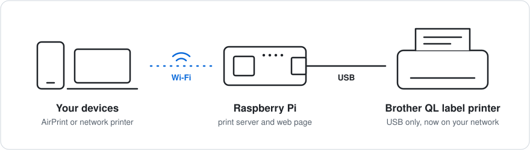
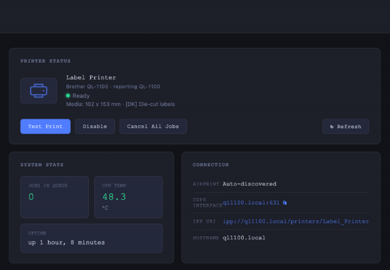
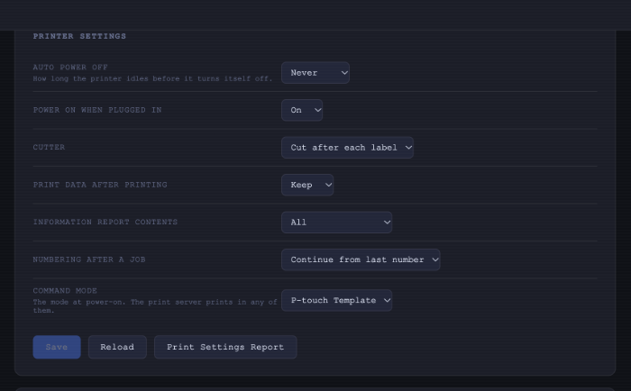

# brother-label-settings

**Put a USB Brother label printer on your Wi-Fi with a small Raspberry Pi.**
Plug the printer into the Pi, run one installer, and it shows up as an AirPrint
and network printer for every phone and computer in the house. A web page on
the Pi shows its status and lets you change the settings stored inside the
printer, including the one that makes it turn itself off.



| Status and connection details | The printer's stored settings |
|---|---|
|  |  |

The repository has two parts, and you can use either alone:

- **[The Raspberry Pi print server](#raspberry-pi-print-server).** The Wi-Fi
  printer above. Built for and tested on a QL-1100.
- **A settings tool** for Linux. Read and change the settings stored inside 14
  QL and PT models over USB. The one most people come for is **auto power
  off**: the printer turns itself off after a while, and the only official way
  to stop that is Brother's Printer Setting Tool on Windows or macOS.

```console
$ brother-label-settings show
# QL-1100
auto_power_off               4 hours (0x18)
auto_power_on                Off (0x00)
cut_mode                     Cut after each label (0x01)
print_data_after_printing    Keep (0x00)
info_report                  All (0x03)
serialize_mode               Continue from last number (0x01)
command_mode                 P-touch Template (0x03)

$ brother-label-settings set auto_power_off=0
# QL-1100
auto_power_off               Never (0x00)
...
```

This project is not affiliated with or endorsed by Brother Industries.

## What has been tested

**Only the QL-1100 has been tested on a real printer.** Every other model's
table comes from the same source and has the same shape, but nobody has run it
against the hardware yet.

| | Status |
|---|---|
| QL-1100, reading all 7 settings | Tested on hardware |
| QL-1100, writing | Auto power off and power-on were changed through the print server's web page and read back correctly. The other five settings have not been written. |
| QL-1100, settings report and factory reset | Not tested |
| QL-600, QL-800, QL-810W, QL-820NWB, QL-1110NWB | Not tested |
| PT-D800W, PT-E800W, PT-P710BT, PT-P715eBT, PT-P900W, PT-P910BT, PT-P950NW | Not tested |
| TP-M5000N | Not tested |
| Print server on a Pi Zero 2 W with a QL-1100 | Runs on one Pi: the shared queue, the web page, and reading settings through it |
| Print server installer (`install.sh`) | Written from that Pi's configuration. Not run on a fresh system. |
| Log kept on disk, and the optional `slim-down.sh` | Both are in place on that Pi and survive a reboot. `slim-down.sh` itself has only been run there, where the services were already off. |
| Settings in the macOS print dialog | macOS 27 accepts the PPD and lists the options. Add Printer lists the installed driver under Select Software, but does not select it automatically. Not checked: a job carrying an option through to the printer. |
| Print server with any other model | Not tested |

If you have one of the untested models, `show` only reads, so it is the safe
first step. Please open an issue with the output either way, working or not.

## Install

Linux with the kernel's `usblp` driver (it is what creates `/dev/usb/lp0`),
Python 3.9 or newer, no dependencies.

```bash
pip install git+https://github.com/toml0006/brother-label-settings
```

Your user needs to be in the group that owns `/dev/usb/lp0`, usually `lp`:
`sudo usermod -aG lp $USER`, then log in again.

## Use

```bash
brother-label-settings show                    # read everything
brother-label-settings show --json
brother-label-settings set auto_power_off=0    # one or more key=value pairs
brother-label-settings models                  # every model, setting and value
brother-label-settings --model QL-800 models   # one model
brother-label-settings print-report            # prints on the loaded labels
brother-label-settings factory-reset --yes
```

The printer is asked which model it is. `--model QL-800` overrides that, and
`--device` picks a device other than `/dev/usb/lp0`.

Values are the numbers `models` lists, in decimal or hex (`0x18`). A value the
model's table does not list is refused before anything is sent.

Do not run it while a job is printing: every exchange starts by resetting the
printer's command state.

## Models and settings

| Model | Settings | Settings report |
|---|---|---|
| QL-600 | `auto_power_off`, `auto_power_on`, `print_data_after_printing` | no |
| QL-800 | `auto_power_off`, `auto_power_on`, `print_density_1`, `print_density_2`, `print_data_after_printing` | no |
| QL-810W | `auto_power_off`, `auto_power_off_battery`, `auto_power_on`, `print_density_1`, `print_density_2`, `battery_charge_limit`, `print_data_after_printing`, `info_report`, `command_mode` | yes |
| QL-820NWB | `auto_power_off`, `auto_power_off_battery`, `auto_power_on`, `print_density_1`, `print_density_2`, `battery_charge_limit`, `print_data_after_printing`, `info_report`, `command_mode` | yes |
| QL-1100 | `auto_power_off`, `auto_power_on`, `cut_mode`, `print_data_after_printing`, `info_report`, `serialize_mode`, `command_mode` | yes |
| QL-1110NWB | `auto_power_off`, `auto_power_on`, `cut_mode`, `print_data_after_printing`, `info_report`, `serialize_mode`, `command_mode` | yes |
| PT-D800W, PT-E800W, PT-P900W, PT-P950NW | `auto_power_off`, `auto_power_off_battery`, `auto_power_on`, `length_adjustment`, `full_cut_margin`, `half_cut_margin`, `info_report`, `save_print_log` | yes |
| PT-P710BT, PT-P715eBT | `auto_power_off`, `auto_power_off_battery`, `auto_power_on`, `length_adjustment`, `info_report` | yes |
| PT-P910BT | `auto_power_off`, `auto_power_off_battery`, `auto_power_on`, `length_adjustment`, `full_cut_margin`, `half_cut_margin`, `special_tape_feed`, `info_report` | yes |
| TP-M5000N | `auto_power_off`, `print_position` | no |

The same setting name can mean different commands and different values on
different models: `auto_power_off` goes up to 12 hours on a QL-1100 and to one
hour on a QL-800. `brother-label-settings models` prints the exact values.

Not covered: Wi-Fi and Bluetooth settings on any model, and the PJ mobile
printers, which use other mechanisms.

## Raspberry Pi print server

A QL-1100 has USB and nothing else. A Raspberry Pi next to it puts it on the
network:

- **AirPrint.** It appears on macOS, iOS and iPadOS with nothing to install.
- **Network printer.** A shared CUPS queue (IPP) for Linux and Windows.
- **Auto-fit.** A PDF or image is trimmed to its content and scaled to the
  label, so a shipping label on a letter-size page prints as a 4 x 6 label.
- **Web page** on port 9631: printer status, loaded label size, job queue, PDF
  upload, and the printer's stored settings.
- **macOS print dialog.** Optionally, a driver for the Mac that adds the
  stored settings as print options. You pick it when adding the printer.

With Raspberry Pi OS on the Pi, the Pi on your network and the printer plugged
into it:

```bash
git clone https://github.com/toml0006/brother-label-settings
cd brother-label-settings/print-server
sudo ./install.sh
```

Then add "Label Printer" on your devices, and open
`http://<hostname>.local:9631` for the web page.

Read these before relying on it:

- The installer mirrors one working Pi and has not been run on a fresh system.
- The web page has no login. Keep the Pi on a network you trust.
- Apple devices need a certificate that expires: re-run the installer within
  the year.
- The label sizes are the QL-1100's.

[print-server/README.md](print-server/README.md) has the details: what the
installer changes, adding the printer on each system, the certificate, and the
macOS print dialog.

## From Python

```python
from brother_label_settings import MODELS, UsbLp, read_settings, write_settings

model = MODELS["QL-1100"]
with UsbLp("/dev/usb/lp0") as printer:
    write_settings(printer, model, {"auto_power_off": 0})
    print(read_settings(printer, model))
```

`read_settings` and `write_settings` take any object with `write(data)` and
`read(size, timeout=...)`, so another transport is a small class.

## Limits

- Linux and USB only. The network-capable models are not reachable over the
  network with this.
- One program can hold `/dev/usb/lp0` at a time. If something else is talking
  to the printer, opening it waits up to three seconds and then fails.
- An unlisted value is refused. Whether a printer accepts values between the
  listed ones (a 30-minute timeout on a QL-1100, say) is unknown.

## How the commands were found

Brother's Printer Setting Tool carries one definition per printer model: for
each setting, a command that reads it, a command that writes it, and the values
it can take. The tables in [`models.py`](brother_label_settings/models.py) hold
those commands and values, with this project's own names.
[docs/PROTOCOL.md](docs/PROTOCOL.md) describes the exchange and what a real
QL-1100 sends back.

None of Brother's files, text or code is included here.

## Related projects

This is not a printer driver, and it is not the only way to use these printers
on Linux.

- [brother_ql](https://github.com/matmair/brother_ql-inventree) prints to QL
  printers from Python and the command line. The print server here uses it.
- [cups-rastertoql](https://flap.codeberg.page/cups-rastertoql) is a CUPS
  driver for the QL family. It can also set the power-off timeout as a print
  option on the models it covers.
- Brother publishes its own Linux printing drivers for many models.

What this project adds: it reads the settings back from the printer, so you can
see what is stored; it covers the other stored settings as well as power off;
and its tables include the QL-1100, QL-1110NWB and the PT models.

## Development

```bash
pip install pytest
python -m pytest
```

The tests use a fake printer and need no hardware.

## License

MIT. See [LICENSE](LICENSE).
